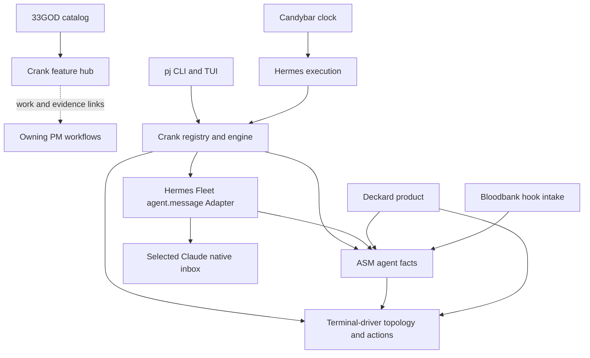

# Architecture Spine — I-9 crank feature hub

**Final architecture agreement, not execution authorization.** Delegated
pjangler-pm accepted pane-bound local-Linux Claude native messaging and Hermes
Fleet's narrow `agent.message` planning ownership. Fresh independent reconciliation,
quality review and targeted fix recheck passed. Claude remains a capability-gated
candidate, not certified support. No API existence, owner work acceptance,
behavioral proof or economics-cap change is implied. See
[final gate disposition](reviews/final-gates.md),
[route provenance/impact](route-disposition.md) and
[mechanism evidence](delivery-feasibility.md).

## Design paradigm

Layered composition through owner **Adapters** and **Facades**. The crank hub is
the entry point for a feature change; its participants retain their own domains,
implementation backlogs and execution authority. The parent fixes cross-owner
invariants, not child code structure. No universal orchestrator is introduced.

`[ADOPTED]` identifies a prior direct operator or delegated PM boundary; attribution
remains in the source PRD and decision log. Untagged rules and explicitly labeled
**Engineering decisions** are architectural derivations reviewed for this contract,
not newly elicited product decisions or evidence of implementation.

Arrows describe permitted logical consumption/dispatch, not an installed transport
or new package dependency. The hub may contain crank-owned implementation, never
participant implementation. Terminal-driver does not depend on ASM or Deckard;
it owns topology/actions, not agent classification or this native input route.
Hermes Fleet consumes ASM identity and owns the native Adapter; crank alone owns
permission/admission. The route remains pane-bound, despite using native messaging.

## Invariants and rules

### AD-1 — Feature coordination links existing authorities [ADOPTED]

- **Binds:** FR-1–5, FR-9; catalog, hub and owning PMs.
- **Prevents:** monolithic feature repos, duplicate backlogs and a second execution engine.
- **Rule:** The central catalog points to the dedicated crank hub. The hub links
  outcome, boundaries, owner contracts, authoritative existing work/dependencies,
  integrated procedure and evidence. Participant scope/status remains with its
  owner. Handoffs use actual owner intake and enrollment, with acceptance/blocking
  evidence; documented manual handoffs are sufficient initially. No parent-owned
  component stories or implementation loop. Missing contracts are visible gaps.
  Ordinary defects go to the true owner. Escalate only a genuine access, authority,
  scope/ownership, spend/cap or unresolved consequential product tradeoff, presenting
  one exact decision, recommendation and supporting evidence—not operator takeover.

### AD-2 — Each domain has one mutation authority [ADOPTED]

- **Binds:** all participating owners; FR-2–4, NFR-1.
- **Prevents:** private agent folds, competing registry writers and reverse product dependencies.
- **Rule:** ASM owns agent process/identity/session/state; terminal-driver owns
  topology/actions; crank owns opt-in, registry, eligibility and engine; pj owns
  project identity and its CLI/TUI integration. Bloodbank owns hook intake/event
  contracts, Hermes execution, Candybar recurring dispatch, and existing enrolled
  ticket systems their lifecycle. **Delegated addition, 2026-11-08:** Hermes Fleet
  owns the narrow native `agent.message` Adapter contract: compatibility, connected
  endpoint/session validation, submission and accurately bounded receipts. This is
  planning ownership, not PM intake acceptance or an existing API. No duplicate
  detection, input stack or new runtime is introduced. Read-side products consume
  owner facts. Deckard
  requires ASM, with no independent fallback fold. Provisional providers must be
  explicitly identified and replaced through independently checked owner contracts.

### AD-3 — Opt-in belongs to a particular live session [ADOPTED]

- **Binds:** crank registry/engine, ASM identity and pj selection; FR-6, NFR-2.
- **Prevents:** tab rename, pane reuse, shared cwd or native-session resume transferring permission.
- **Rule:** Permission must not transfer to a different live agent. **Engineering
  decision:** explicit opt-in binds an owner-qualified CLI/native session and the
  selected process incarnation. Tab names/order and pane/project location are
  metadata, never authorization. Different process incarnation, session rotation,
  ambiguous identity or unverified location refuses input and requires fresh
  explicit selection for this increment. Cross-pane migration and restart recovery
  are not automatically inferred from a matching native session ID.

### AD-4 — Identity observations carry evidence and unknown states

- **Binds:** ASM/terminal/crank seam; FR-2, FR-6, NFR-2.
- **Prevents:** session collisions, PID reuse, ghost observations and empty meaning both unknown and none.
- **Rule:** Owner contracts distinguish resolved, absent, stale, ambiguous and
  unsupported. A resolved identity includes identity namespace, CLI/native session,
  process incarnation (host/boot boundary, PID and process start token), observation
  time and terminal association where known. Freshness/expiry semantics and clocks
  are owner-defined and shared by consumers, not consumer-invented thresholds.
  Missing/expired/conflicting evidence cannot mean idle or authorized. Native
  session IDs are opaque and case-sensitive; display labels never act as keys.
  Owner contract must specify canonical field representations, equality rules,
  namespace qualification and any conversion authority. Exact wire encodings belong
  to those contracts before any dependent implementation.

### AD-5 — Native submission under uninterrupted authority [ADOPTED]

- **Binds:** crank admission, ASM facts and Hermes Fleet `agent.message`; FR-6, NFR-2.
- **Prevents:** check-then-send retargeting, revoked/stale-worker submission and terminal fallback.
- **Rule:** First proof uses only the pane-bound local-Linux Claude native-message
  candidate; no terminal fallback or other CLI. Hermes Fleet must bind the connected
  endpoint to the selected process/native-session incarnation, protecting it through
  asynchronous ingress. Unknown, changed or unsupported capabilities produce zero
  submission with a reason, never a weaker guarantee. Crank retains one final submit
  authority: workers propose attempts but cannot send independently. Uninterrupted
  exclusion covers endpoint validation, last-enforceable-point binding/revocation/
  fresh eligibility revalidation and irreversible submission through the Adapter.
  Revocation ordered before that point prevents new submission. A lease check then
  unfenced write is insufficient; a successor cannot send while an old worker can
  still submit. After possible submission no retraction, cancellation or continuous-
  idleness promise is made; later native hold/release may occur. No native settings
  are changed to force delivery. External schema compatibility, exact session-
  incarnation protection through async ingress and independent receiving-input
  acceptance evidence are blocking enablement/proof gates, not assumed capabilities.
  Unsupported means no send. Assignment is planning only; actual implementation
  goes through Hermes Fleet's PM/intake under separate execution authority.

### AD-6 — An attempted send is not an observed delivery

- **Binds:** crank engine, retries, dashboard and evidence; FR-6–8.
- **Prevents:** duplicate nudges and exit-zero/eligibility masquerading as delivery.
- **Rule:** Crank owns stable action/attempt identity and serialization per binding:
  one logical action per binding and admitted trigger occurrence; retries reuse that
  identity. The accepted contract must define occurrence equivalence and deduplication
  lifetime, not allocate fresh action IDs for duplicate dispatch. Persist the
  stable attempt before any possible submission. An
  old worker losing its authority cannot send after a successor takes over; exact
  exclusion/fencing must be established with AD-5 before delivery is enabled.
  Distinguish proposed/admitted, transport-submitted, held/refused/dropped,
  receiving-input-accepted and subsequent processing. Only independently
  corroborated input acceptance of the stable marker/body at the bound receiving
  session permits observed-delivered; sender success, preview or a status named
  `delivered` alone does not. Model consumption/task completion is not required.
  Possible submission followed by crash/timeout is outcome-unknown. Fence replay
  and new nudges to that receiving process/native-session incarnation across opt-out,
  re-opt-in, replacement binding IDs and authority takeover. Clear the fence only
  on corroborated receiving-input acceptance (complete the original action without
  replay), or terminal nonacceptance that rules out any later native release.
  Silence, timeout, held status and a new binding do not reconcile it. Do not claim
  universal exactly-once across registry, sender and receiving CLI.

### AD-7 — Extend the existing pj project dashboard

- **Binds:** pj integration and crank read contract; FR-6, FR-9.
- **Prevents:** a new dashboard project and UI-owned registry mutations.
- **Rule:** Use the existing `pj crank tui` project surface. Its target read model
  shows selected CLI/session/process, current pane/tab, opt-in, freshness and actual
  nudge/skip/delivery status with actionable reason. Its mutations go through crank's
  authority, not direct non-owner Redis writes. The present tab-keyed screen is
  migration input, not evidence that session-bound UI already exists.

### AD-8 — Evidence is attempt-scoped, immutable and source-bound [ADOPTED]

- **Binds:** hub, owners, reviewers and evidence consumers; FR-7–9, NFR-3.
- **Prevents:** old green results certifying changed code and copied ticket states.
- **Rule:** Evidence must bind actual results to exact tested revisions/conditions.
  **Engineering decision:** each immutable attempt records procedure version, exact participant revisions,
  dirty-source digest if applicable, executed artifact/version/digest, relevant
  configuration/conditions, authorization scope, expected/observed scenario results,
  observer/reviewer identity, failures, limitations and resolvable evidence links.
  Secrets are not captured. The hub indexes the latest attempt without erasing old
  failures. Changed revisions/conditions make old proof historical. Component repos
  own contract/probes; crank owns integrated procedure/result references; Candystore
  remains durable operational context. Implemented, local-tested, integrated-tested,
  installed and deployed remain separate claims. Missing evidence is not a pass.

### AD-9 — Proof observes real destinations and exclusions

- **Binds:** future integrated procedure and independent observer; FR-6–9.
- **Prevents:** synthetic agreement and observing only the successful target.
- **Rule:** Use separately authorized disposable **real agent** sessions in an
  isolated Zellij session and explicit throwaway Redis endpoint/key/channel namespace,
  never operator panes or production Redis. Record every destination in the scenario.
  Independent process/native-session corroboration uses underlying process/session
  evidence, not another consumer of ASM. Observe native submissions and receiving
  inputs, not only terminal keys. Correlate per-scenario attempt marker/body and
  receiving session with all attempted input actions; complete bounded observations of
  neighboring, disabled, replacement and empty-pane destinations must establish zero
  input, not merely absence of one expected token. Missing coverage stays unproven.
  Setup/reset, expected/observed result, stop conditions, exact configuration and
  evidence locations are required. This rule is a future protocol, not permission
  to create sessions or run input now.

### AD-10 — Three results cannot promote each other [ADOPTED]

- **Binds:** hub acceptance/evidence and initiative reporting; PRD §7.
- **Prevents:** workflow success becoming behavior success or scoped proof becoming I-8 completion.
- **Rule:** Separately evidence reusable hub/workflow demonstration, scoped FR-6
  behavioral proof and full I-8 acceptance. Each states passed, failed, unproven or
  not-run and its evidence. A fresh-agent exercise may demonstrate an honest failed
  handoff, not crank behavior. Full I-8 pane-movement/restart requirements and the
  existing cap-lift condition remain unchanged.

### AD-11 — Migrate by required contract readiness [ADOPTED]

- **Binds:** owners and migration acceptance; FR-2–4, FR-8, NFR-4.
- **Prevents:** whole-platform prerequisites, duplicate active writers and declaring a target installed.
- **Rule:** Reuse BB-32/BB-33, PJAN-202 and existing I-8 work after current verification.
  Keep current providers visibly provisional until independently corroborated live
  differential/contract proof supports replacement. Switch each mutable domain to
  one writer; do not dual-write opt-in registries or preserve autonomous profile
  engine copies. A shadow read cannot send. Owner fixes receive independent review,
  then the failed seam and relevant regressions rerun. Ordinary retries require
  new evidence of progress; repeated failures without
  progress trigger diagnosis/course correction rather than blind reruns. Unrelated
  ready work may continue; dependency readiness is never
  inferred from a Done ticket. **Engineering decision:** domain-at-a-time writer
  cutover and shadow-read exclusion above. No cutover or cleanup is authorized by this contract.

### AD-12 — Preserve the operational envelope [ADOPTED]

- **Binds:** feature/runtime configuration and delivery; NFR-4.
- **Prevents:** hidden clocks, permanent pins, hardcoded host IDs and planning-driven deployment.
- **Rule:** **Engineering decision:** retain existing Linux/Zellij and owner runtime
  boundaries; no new cloud, provider, service listener or clock is required for this
  increment. Candybar owns
  recurring dispatch; Hermes jobs remain externally scheduled. Keep the cap unchanged.
  Resolve runtime job/session/resource IDs through owner configuration/receipts and
  service hostnames, not feature logic constants. Hosts hold pointers/generated stubs,
  not divergent logic. Secrets use environment or `op://` references. Source tracks
  main; exceptional pins carry a reason/exit ticket. Exact tested/deployed revisions
  remain recorded independently of main. Production delivery needs existing authority;
  no new signoff ritual is added.

## Minimum owner-contract readiness

| Seam | Required before scoped input proof | Current source reality, not deployment |
| --- | --- | --- |
| ASM → crank | Independently corroborated process/native-session identity and eligibility/freshness | Bloodbank `34a18a1`: session fields empty in observer path; BB-33 mechanism persists |
| Terminal-driver → crank/ASM | Topology and process-to-pane location corroboration; no native-input responsibility | New checkout absent; current raw pane-ID beat input is not the selected route |
| Hermes Fleet → crank | Capability-gated `agent.message`, connected incarnation protection through ingress, bounded receipts and independent receiving-input acceptance | Planning owner assigned; no API/intake acceptance certified; external schema, async session fence and observer remain blocking enablement/proof gates |
| Crank → pj/runner | Session/process-bound opt-in, one mutation authority and action outcome | New checkout absent; pj and existing engine still use tab/pane settings |
| PJAN-202 provisional inventory | Explicit unknowns; independent source corroboration | pjangler `02eeee1`: Claude start-token check exists; public inventory omits that token; other native sessions unresolved |
| Test/runtime separation | Throwaway Redis endpoint plus key/channel isolation | BB-32 remains: test defaults to production endpoint/fixed transition channel; do not run bare |
| Hub/workflow | Formal home, links, accepted owner handoffs and fresh-agent evidence | Catalog says scattered; no hub exercise or behavior proof performed |

These findings were returned by the independent read-only source check on
2026-11-08; Hermes Fleet's planning assignment comes from the later delegated
disposition. Neither is a live runtime probe. See [review provenance](reviews/gate-disposition.md).
The engine directory was unversioned in that check, so its source revision cannot
be certified. These are contract outcomes, not component tasks. No full ASM/Deckard/consumer
migration is required merely to demonstrate the hub; required missing contracts
still block dependent input proof. Do not broaden supported agent types by guessing
session identity. Owners must declare supported identities and observable errors.

## Integrated procedure seed

Future crank-owned procedure, to be completed against actual owner interfaces:

1. Resolve permission, participant builds/configuration and the capability-gated
   pane-bound local-Linux Claude cohort: selected disposable agent, neighboring
   disabled agent, replacement and empty-pane cases. First satisfy schema
   compatibility, async incarnation protection and independent acceptance-observer
   gates. Verify isolation and that production dispatch cannot reach test targets.
   Unsupported/missing evidence permits no submission.
2. Independently corroborate session/process/pane identity. Record opt-in and
   expected target; start complete bounded native-submit/receiving-input traces.
3. Exercise one admitted action across tab rename/reorder with exactly one observed
   intended input acceptance. Separately cover disabled, unknown, stale, no-agent,
   process/session replacement, duplicate dispatch and unknown outcome. Exercise
   revocation ordered before final revalidation, post-submit changes and paused old
   sender/takeover: pre-point revocation prevents submit; after possible submit
   neither retraction nor continuous idle is promised. Unknown fences new nudges
   and replay. Every scenario has expected versus observed complete positive and
   negative evidence; terminal silence alone establishes no native exclusion.
4. Stop on any identity discrepancy, unintended input, observation gap or unapproved
   side effect. Record failed versus unproven accurately; route repairs to owners.
5. Archive expected/observed results and exact executed revisions/conditions. Independently
   review fixes before rerun. A fresh agent follows hub links, reuses owner work and
   performs/delegates only permitted steps, then reports the three separate results.

No proof commands or nonexistent APIs are invented here. The selected CLI/route is
agreed; owner capability contracts and observation mechanisms must exist before
input can be enabled or this procedure executed. Missing wrappers alone do not
prevent agreement on this architecture.

## Deferred and open decisions

- **OQ-1 — Resolved for architecture:** delegated pjangler-pm accepted the
  pane-bound local-Linux Claude native-message candidate and Hermes Fleet's narrow
  `agent.message` planning ownership, with AD-5's uninterrupted submit exclusion
  and explicit post-submission limits. Terminal fallback is forbidden. FR-2's
  conflicting route wording was narrowly amended; FR-6/NFRs and other owners are
  unchanged. [Provenance/change impact](route-disposition.md).
- **OQ-2 — Blocking enablement/proof gates, not architecture disagreement:**
  external schema/compatibility support, exact process/native-session incarnation
  protection through asynchronous ingress and independently observable receiving-
  input acceptance remain unestablished. Claude is a candidate, not certified
  support; every other CLI is unsupported. No input when a gate is unsupported.
  Exact receiving queue admission may qualify only if its binding, semantics and
  independent observation establish CLI input acceptance; internal `delivered`
  naming alone cannot. Model consumption/task completion is not required. Owners
  must supply these capabilities and fresh proof before enablement; if impossible,
  return evidence-backed conflict, never weaken the guarantee or change transport.
  [Feasibility and source limits](delivery-feasibility.md).
- Internal languages, packaging versions, module layout and neutral type encoding:
  component-owned; no new framework/starter or version pin is imposed here.
- Full I-8 cross-pane movement, session rotation/resume and restart recovery:
  remain linked outstanding work, not implicitly waived or authorized now.
- Generic feature install/update/remove, universal orchestration, automatic rollback,
  extra promotions/backends and headless delivery: deferred per PRD; revisit only on
  a demonstrated first-proof dependency and explicit scope disposition.
- ASM visibility, red/amber display semantics and sweeper policy: retain existing
  owner/operator decision boundary; not resolved by creating a new clock or fallback.
- Broader consumer migration (Deckard, Holocene, Wingman, Flume): approved ownership
  direction persists, but not a prerequisite for this narrower hub demonstration.

## Requirement coverage

| Requirement | Governing decisions |
| --- | --- |
| FR-1–2 discovery and ownership | AD-1–4, AD-11 |
| FR-3–5 handoffs, authority and escalation | AD-1–2, AD-11–12 |
| FR-6 identity, dashboard and observed proof | AD-3–7, AD-9; OQ-1 resolved, OQ-2 blocks enablement/proof |
| FR-7–8 evidence and reviewed repair | AD-6, AD-8, AD-10–11 |
| FR-9 independent reuse | AD-1, AD-8–10 |
| NFR-1–4 | AD-2–6, AD-8–12 |
