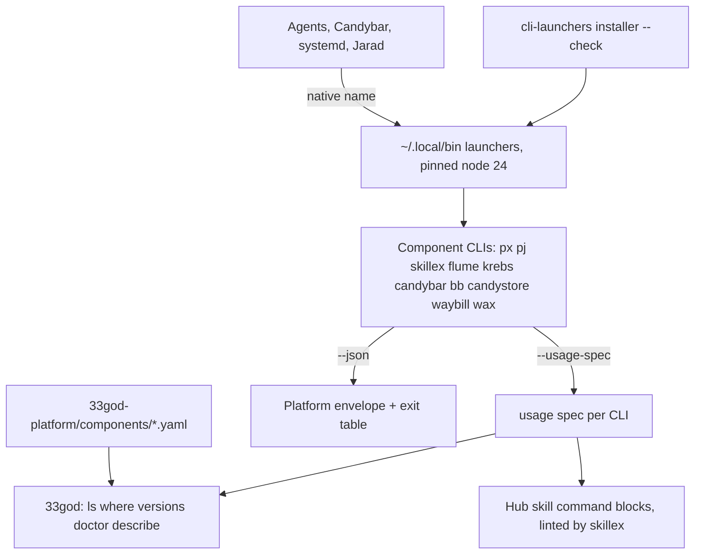

# Architecture Spine — 33GOD CLI surface

**Final architecture agreement for Epic 7, not execution authorization beyond it.**
Jarad approved the direction on 2026-11-19 ("yes! Make sure this is locked in via
appropriate bmad steps, then start on step 1 implementation"). Evidence is in the
[research file](../../research/cli-surface-research-2026-11-19.md); its **corrected
verdict** section is authoritative and supersedes its design section wherever they
differ. The handoff and checklist are in the
[sprint change proposal](../../sprint-change-proposal-2026-11-19.md).

## Design paradigm

**Follow AWS's contract, not its monolith.** `aws` drives 426 services because each
service ships a machine-readable model and one shared config/output layer reads
them; the binary itself is incidental, and AWS keeps its workflow tools (sam, cdk,
eb, session-manager-plugin) as separate binaries. Every 33GOD CLI is a workflow tool
of that second kind, written in Node (commander, parseArgs), Python (Typer,
argparse) and Rust. So 33GOD standardises the **contract** (describe spec, envelope,
exit table, pinned runtime) and keeps the **native binaries** as the way things run.
A small `33god` command reads the contract for discovery and health only.

`[ADOPTED]` marks a rule the operator approved on 2026-11-19 in the decision text.
`[PROPOSED]` marks an engineering derivation in this spine that Grolf may revise at
a story verdict without reopening the decision.

Arrows are logical reads. `33god` never sits between a caller and a component.

## Requirements (this spine's own; no PRD covers the CLI surface)

| ID | Requirement |
|---|---|
| CS-1 | Any 33GOD component CLI runs by its native name from any cwd and a minimal PATH, on the runtime it needs. |
| CS-2 | Each component describes its command surface in a machine-readable standard spec. |
| CS-3 | Machine output uses one envelope, and process exit uses one code table. |
| CS-4 | An agent can list, locate, version-check and health-check every component CLI from one place. |
| CS-5 | No CLI spelling can bypass an existing guard (Candybar-only clock, crank keys). |
| CS-6 | mise and the CLIs have a written boundary; skill-op and pure alias tasks are retired without losing build, deploy or bootstrap behaviour. |

## Invariants and rules

### AD-1 — Native binary names are canonical [ADOPTED]

- **Binds:** CS-1, CS-5; skills, guards, Candybar manifests, docs.
- **Prevents:** a second spelling for every command, and guards that stop matching.
- **Rule:** `px`, `pj`, `skillex`, `candybar`, `flume`, `bb`, `candystore`, `krebs`,
  `waybill`, `wax` stay the execution spelling in skills, guards and Candybar argv.
  `33god` is never written into a manifest, hook or skill as a way to run a
  component. Aliases (`fl`, `cs`, `pilot`, `pjangler`) may exist on PATH but are not
  cited in skills.

### AD-2 — Launchers pin their interpreter [ADOPTED]

- **Binds:** CS-1; Story 7.1 AC1-AC3.
- **Prevents:** `#!/usr/bin/env node` picking `/usr/bin/node` v20.19.4 under systemd
  or `env -i` (skillex `E_NODE_VERSION`, exit 2), or a cwd mise pin of node 20/22.
- **Rule:** every Node component launcher in `~/.local/bin` execs a pinned Node >= 24
  with the CLI's real entry file. One tracked, idempotent installer in the 33GOD repo
  (33god-platform) writes the wrappers from a declared list and has a `--check` mode
  that exits nonzero on drift. It resolves the interpreter through mise (`mise where
  node@24`, or the `~/.local/share/mise/installs/node/24` alias), never a hardcoded
  Linux path, so it runs on the Mac peer. Python CLIs stay on their uv tool venvs or
  launchers and are listed as already pinned unless `--check` finds them broken
  under the minimal PATH. Candybar manifests call the launcher by absolute path
  (`~/.local/bin/krebs tick --json`), not `node` plus a repo path.
- **Engineering note [PROPOSED]:** wrappers, not symlinks, because a symlink to a
  `#!/usr/bin/env node` file inherits PATH resolution.

### AD-3 — The `usage` spec is the describe contract [ADOPTED]

- **Binds:** CS-2; Stories 7.2, 7.4, 7.7.
- **Prevents:** a hand-rolled `33god.cli/1` schema plus per-framework helpers to
  maintain (rejected by the critique; it fails `stay-on-the-edge`).
- **Rule:** each component answers `<cli> --usage-spec` through the existing exporter
  for its framework (`@usage-spec/commander` on npm; `usage-spec-typer` and
  `argparse-usage` on PyPI; the `clap_usage` crate), or ships a static `.usage.kdl`
  where no exporter fits. Upgrade usage-cli from 3.3.0 to the current release before
  the first conversion. Exporter packages are verified to exist and work before a
  story depends on them. **Do not invent a `33god.cli/1` schema.**
- **Generated vs authored [PROPOSED]:** syntax (paths, flags, args) comes from the
  parser. Effect annotations (read/write/destructive, idempotent) are authored next
  to the code and reviewed; nothing exposes a command remotely on the strength of an
  unreviewed annotation.

### AD-4 — One JSON envelope, a superset of skillex v2 [ADOPTED]

- **Binds:** CS-3; Story 7.3.
- **Prevents:** five parsers per agent, and breaking existing JSON consumers.
- **Rule:** the platform envelope is a superset of skillex's
  `{schema, command, ok, exit, data, findings}` v2 (`skillex src/core/result.ts`);
  skillex already satisfies it. Extra fields are optional. Components convert one at
  a time, in order of agent call frequency.
- **Consumers first:** pj keeps raw `pj list --json` until pilot
  (`providers/registry.js:61`) and candystore (`projects.py:75`) move to the
  envelope. flume adds a `schema` alias before dropping `schema_version`, behind the
  same rule (flume-mcp and `validateFleetEnvelope` consume it).

### AD-5 — One exit-code table [ADOPTED]

- **Binds:** CS-3; Stories 7.3, 7.4.
- **Rule:** skillex's table is the platform table: `0` ok, `1` failure, `2`
  usage/config (including unknown command), `3` refused, `4` partial, `5`
  lock-busy/retry, `6` drift, `130` interrupted. A component whose native codes
  differ (candybar doctor 1=bypass/2=unknown; wax doctor 1=warn/2=fail) declares a
  native-to-platform map until it converts, so `doctor --all` can normalise.

### AD-6 — One skillex, without a hard pin [ADOPTED]

- **Binds:** CS-1; Story 7.1 AC5; features.toml F3; 2026-11-08 spine AD-12.
- **Prevents:** `pj skills` running a different skillex than PATH, and a permanent pin.
- **Rule:** the skillex on PATH equals the latest npm release; stale co-installed
  mise versions are pruned; `pj skills` execs PATH skillex and pjangler drops its
  bundled `@delorenj/skillex` dependency. **Deviation from the earlier draft:**
  skillex is not hard-pinned in the mise config, because F3 says track main and no
  pin without a reason and an exit ticket. Skew detection arrives with
  `33god versions` (AD-7). flume's `github:delorenj/skillex#<sha>` pin is reported,
  not changed; it needs a reason and exit ticket under F3.

### AD-7 — `33god` is discovery and health only [ADOPTED]

- **Binds:** CS-4; Story 7.4.
- **Prevents:** a passthrough umbrella becoming a monolith or a guard bypass.
- **Rule:** `33god ls`, `where`, `versions`, `doctor --all`, `describe`. It reads
  the component registry (`33god-platform/components/*.yaml`, the one registry, no
  fourth list) and the usage specs. It may start as `platform.py` subcommands. It
  owns no atom (an L4 consumer in the 33god-features layer table). **No
  passthrough** until AD-8 is satisfied.
- **Engineering note [PROPOSED]:** the registry gains whatever minimal invocation
  fields `where`/`versions` need (binary name, how to read a version) as an
  orthogonal block; `kind` is left alone.

### AD-8 — Guards unwrap `33god` before any passthrough exists [ADOPTED]

- **Binds:** CS-5; Story 7.5.
- **Prevents:** `33god hermes cron create` slipping past the Candybar-only-clock rule.
- **Rule:** every argv-parsing guard (first: bloodbank hook-hub
  `native_clock_guard.py`, whose `strip_prefix` knows env/sudo/nohup/timeout/nice/exec
  and then branches on `name == "hermes"`) unwraps `33god` and maps registry aliases
  to canonical names, with a guard test per alias. Until then `33god` has no
  passthrough at all.

### AD-9 — The mise boundary [ADOPTED]

- **Binds:** CS-6; Story 7.6.
- **Rule:** if a task operates on the running platform, crosses repos, or must be
  callable from any cwd by an agent, Candybar, the bus or MCP, it is a CLI command.
  If it builds, tests, pins or bootstraps this repo, it is a mise task.
- **Mise keeps:** `[tools]` and runtime pins, `[env]`, enter/leave hooks, per-repo
  build/test with `depends`/`watch_files`, every deploy task (including
  mobile-deploy-hub `mise run deploy`), and its role as the deployment mechanism on
  the Mac peer.
- **Deletion test:** a task is deleted only when its body is exactly `<cli> <args>`
  with no `depends`, `env` or `dir`, and every doc and skill that cites it is
  rewritten in the same commit (flume `org:*` declare `depends = ["build"]` and are
  not aliases).
- **skills:sync:** retired fleet-wide with `skillex integrations retire-mise`
  **after** its matchers are narrowed (today they would delete Milkshake
  `skill:link`/`skill:reference`, pilot `skill:surface`, IntelliForia
  `skills:bootstrap`/`local`/`library:pull`), and the generators that emit it are
  fixed (hermes-agent-template, `flume/templates/hermes-agent`).

### AD-10 — Projections wait for a real caller [ADOPTED]

- **Binds:** Belsky bound; deferred list below.
- **Rule:** hub-skill command blocks are generated from usage specs, with drift
  checked in `skillex skill lint` (hub linting belongs to skillex under ADR-0002).
  A Bloodbank CLI-runner and an mcp-hub `cli` domain are **not built now**.

## Belsky level

Pillar `belsky-doctrine`. Asker's level: Jarad's agents need a CLI surface that works
from any shell. One level up, and no further: **every 33GOD component CLI** is on PATH
with a pinned runtime, describes itself in a standard spec, and speaks one envelope and
one exit table. Not every CLI on the machine, and not a CLI platform with its own
schema, conform framework and four projections (two levels up, ruled out). External
tools (hindsight, the hermes fork, wax from HeyMa) join only through static specs, and
only if a story asks.

Other pillars: `agent-is-an-employee` (one directory of tools that behave the same),
`it-behaves-like-it-looks` (the name you type is the binary that runs; no silent
version proxy), `stay-on-the-edge` (use `usage`, do not hand-roll), `reversible-beats-cautious`
(per-component conversion, wrappers regenerable), `homelab-is-not-a-nasa-lab` (no
credential chain, profiles or JMESPath layer).

## Deferred and open decisions

- **Bloodbank CLI-runner — not now.** The bus has a closed command vocabulary
  (`bb contract --json` lists fixed actions and entities, each with a holyfields
  schema) and px lifecycle commands carry signed per-actor envelopes. A generic
  runner would step around both. Revisit only when an async or remote caller asks,
  through the typed command plane.
- **mcp-hub `cli` domain — not now.** The hosted mcp.delo.sh container cannot run
  host binaries; a stdio domain needs a read-only default and reviewed annotations.
  Revisit when an agent needs MCP access to a CLI mcp-hub does not cover.
- **`33god` passthrough — blocked** on AD-8 (Story 7.5). Optional convenience for
  Jarad even then; never canonical.
- **Director Rule placement — Grolf's call.** Epic 7 is recorded in `epics.md` as an
  approved exception; Grolf may mirror it as an `I-14` initiative with delegations.
- **Hermes per-PM launcher name — Story 7.1.** The implementers pick the explicit
  name or mechanism that keeps PM-desk HERMES_HOME/profile scoping reachable once it
  stops shadowing global `hermes`; recorded in the 7.1 Dev Agent Record.
- **Hindsight CLI credential.** `~/.hindsight/config` holds a plaintext `api_key`;
  moving it to `op://` via `HINDSIGHT_API_KEY` is outside Epic 7 and noted only.

## Requirement coverage

| Requirement | Governing decisions | Stories |
| --- | --- | --- |
| CS-1 runs anywhere on the right runtime | AD-1, AD-2, AD-6 | 7.1 |
| CS-2 standard self-describe spec | AD-3 | 7.2 |
| CS-3 one envelope, one exit table | AD-4, AD-5 | 7.3 |
| CS-4 discovery and health | AD-7, AD-3, AD-5 | 7.4 |
| CS-5 no guard bypass | AD-1, AD-8 | 7.5 |
| CS-6 mise boundary and cleanup | AD-9, AD-10 | 7.6, 7.7 |
