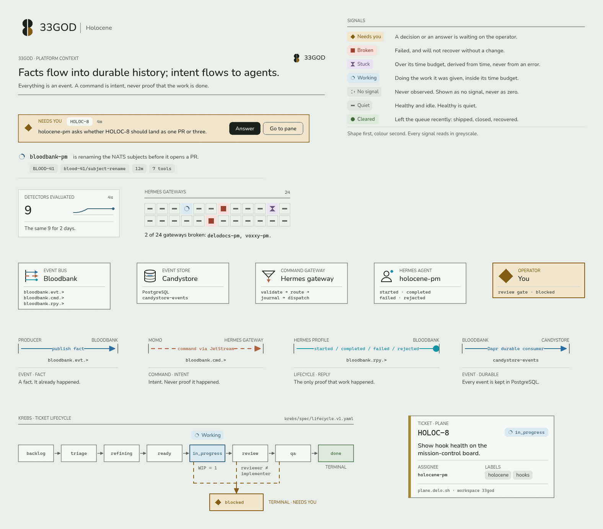

# 33GOD Excalidraw library

A branded Excalidraw library for drawing the 33GOD pipeline. It carries the Holocene "Snow" palette, the 33GOD mark, the seven signal glyphs, one card for every platform component, and typed connectors that keep one meaning everywhere. Everything is a grouped, ready-to-drop unit, so a diagram built from it reads as one system.



The composed example, built only from library items, is `dist/33god-pipeline.excalidraw`: the platform-context event journey from Plane to Holocene and from Momo to a Hermes agent.

## What is in it

54 items, in library order.

### Brand

- 33GOD mark
- 33GOD lockup
- Title block

### Signals

- Signal · Needs you
- Signal · Broken
- Signal · Stuck
- Signal · Working
- Signal · No signal
- Signal · Quiet
- Signal · Cleared
- Signal legend

### Holocene patterns

- Needs you · gate row
- Agent line
- Reading
- Source strip
- All clear
- Census

### Components

- Bloodbank
- Candystore
- Holocene
- Krebs
- PJangler
- Flume
- Momo
- Hermes gateway
- Hermes agent
- Hindsight
- Pipeline MCP Hub
- Skillex
- HeyMa
- Pilot
- External · Plane
- External · n8n
- External · GitHub
- External · Event toaster
- Operator · You
- Worker in worktree

### Flows

- Flow · Publish fact
- Flow · Command intent
- Flow · Lifecycle reply
- Flow · Durable delivery
- Flow · Recall / retain
- Flow · Ticket webhook
- Flow legend
- Event envelope
- Command envelope
- Lifecycle event pair

### Templates

- Krebs lifecycle track
- Ticket card
- Authority boundary
- Facts / intent swimlanes
- Sequence lifelines
- Reject lane
- Dead letter

## Brand rules for diagram authors

Keep these and a new diagram will look like it belongs.

- **Ochre means you.** Only the operator, a gate waiting on the operator, or a ticket blocked on the operator wears ochre. It is never decoration.
- **Healthy is quiet.** A healthy, idle thing is ink-3 with the quiet glyph. Moss is earned: shipped, closed, recovered.
- **Shape before colour.** Every signal has its own glyph, so a diagram still reads in greyscale.
- **Flow colour names the flow, never the state.**

  | Flow | Colour | Line | Head | Meaning |
  |---|---|---|---|---|
  | Event | slate | solid | triangle | A fact. It happened. |
  | Command | clay | dashed | triangle | Intent. Never completion evidence. |
  | Lifecycle | teal | solid | dot | started, completed, failed, rejected. |
  | Ticket | sand | solid | triangle | Plane ticket traffic. |
  | Memory | plum | dotted | open arrow | Hindsight recall and retain. Advisory. |
  | Provision | lichen | solid | bar | Deterministic setup by PJangler. |

- **Machine words are mono.** Subjects, ids, SHAs, units and ticket keys use Cascadia. Prose uses Nunito.
- **Sentence case.** Uppercase only through the small caps label style. No emoji, no exclamation marks, statements end in a period.
- **Hairlines and space, not boxes.** Nodes and panels are sharp. Only chips and buttons round their corners.
- **Draw with the shared vocabulary.** Components come from `brand.node()`, connectors from `brand.flow()`. Roughness is always 0 (architect), and only Nunito and Cascadia are used.

A command is intent, never proof of completion. A diagram that shows work as done must show the correlated lifecycle event.

## Build

```
python3 build.py
```

This validates every item and writes `dist/`. `dist/` is build output and is not tracked; run the build to get the library file:

- `33god.excalidrawlib` is the library.
- `33god-sheet.excalidraw` shows every item by section, for review.
- `33god-pipeline.excalidraw` and `33god-preview.excalidraw` are the composed scenes from `items/showcase.py`.
- `item-names.json` lists the item names.

Ids and seeds derive from item names, so a rebuild with no source change is byte-identical. `python3 build.py --check` validates only. `--only items.flows --out /tmp/x --no-scenes` builds a single module for iteration.

Item modules live in `items/`. Each exposes `ITEMS`, a list of `(name, builder)` pairs, where a builder takes `(x=0, y=0)` and returns Excalidraw elements made by `brand.py`. Add a module to `MODULES` and a section entry to `SECTIONS` in `build.py`.

## Render

Renders use the real Excalidraw 0.18 exporter in headless Chromium, so fonts and arrowheads match what you see in the editor. Fonts load from unpkg, so the first render needs network access.

```
cd render
npm install
node render.mjs ../dist/33god-pipeline.excalidraw out.png --scale 2
node render.mjs ../dist/33god-preview.excalidraw ../dist/33god.png --scale 1
node render.mjs ../dist/33god-sheet.excalidraw sheet-dark.png --dark
```

`dist/33god.png` is the library preview image. The library ships light values only. Excalidraw dark mode inverts the canvas, and the items survive it.

## Import

In Excalidraw, open the library menu, choose Open, and pick `dist/33god.excalidrawlib`. On draw.delo.sh, use the same menu. Drag an item onto the canvas; each one is a single group, so ungroup it to edit the parts.

## Publishing to libraries.excalidraw.com

Publishing follows the [excalidraw-libraries](https://github.com/excalidraw/excalidraw-libraries#create-your-own-library) process.

1. Copy `dist/33god.excalidrawlib` to `libraries/delorenj/33god.excalidrawlib` in a fork of that repository.
2. Copy `dist/33god.png` to `libraries/delorenj/33god.png`.
3. Add an entry to `libraries.json`:

```json
{
  "name": "33GOD",
  "description": "Branded Excalidraw library for the 33GOD event-driven agentic pipeline: Holocene signals, platform components, typed flows and diagram templates.",
  "authors": [{ "name": "Jarad DeLorenzo", "url": "https://github.com/delorenj" }],
  "source": "delorenj/33god.excalidrawlib",
  "preview": "delorenj/33god.png",
  "created": "2026-10-18",
  "updated": "2026-10-18",
  "version": 2,
  "itemNames": []
}
```

Fill `itemNames` from `dist/item-names.json`, in order. The names are English. Each item is useful on its own and none is a lone shape.
