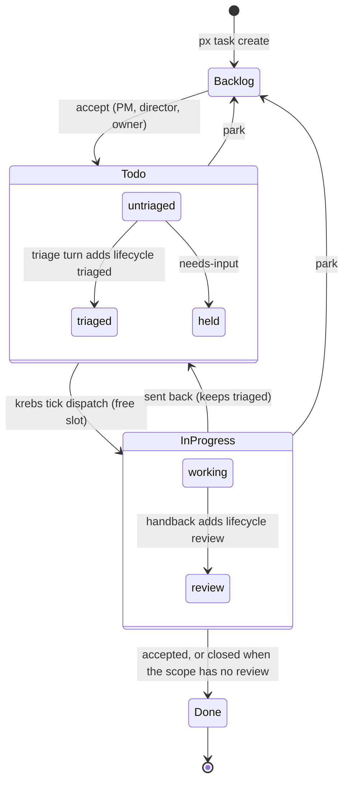

# Krebs lifecycle v2

Krebs is the name of the one ticket lifecycle every 33GOD board follows. It is also the name of the small state manager that enforces it. The machine-readable spec is [`spec/lifecycle.v2.yaml`](../spec/lifecycle.v2.yaml). This page explains it.

It replaces two things:

- The nine-phase v1 lifecycle (its spec was deleted on 2026-11-18).
- Momo, the skill that pushed tickets through the lifecycle by prompt.

## Owner decisions (2026-11-14)

1. **Stock lanes everywhere.** Every board uses Plane's five lanes: Backlog, Todo, In Progress, Done, Cancelled. The nine-lane layout is retired, and labels now carry what the extra lanes used to mean. The verdict rules changed to fit.
2. **Todo means triage, then two slots.** A ticket entering Todo starts a triage turn. When triage finishes it adds `lifecycle:triaged`, and the pickup chip removes `agent:working`. Each project keeps two implementation slots busy with triaged Todo tickets. It stops only when no tickets are left, or when the rest are waiting on a person.
3. **Krebs replaces Momo.** A deterministic state manager now does the work that a prompt-driven skill used to do.
4. **Out of scope.** TIKT keeps its own lanes: it is a human content pipeline, not a ticket board. The client boards AAI and JIMB, in the `automaticai` workspace, are skipped entirely, and Krebs never writes there. Archived boards are left alone.
5. **Epics take a slot.** An epic in In Progress counts against the project's two slots like any other ticket. Krebs never starts an epic itself, so whoever moves one to In Progress spends a slot on it.

6. **Nobody working means no slot (2026-11-18, 33GOD-93).** A ticket whose agent turn ended without a handback or a hold label used to keep its slot, and its leftover `agent:working`, forever. Krebs now asks Candystore whether a turn is live and, if not, releases the ticket to Todo or removes the stale label. See [Orphans](#orphans-the-resume-path).

7. **The PM gives the verdict (2026-11-18).** Launch Directors are retired; a launch is driven by the repo's PM in launch mode. Krebs sends the scope's PM a review turn for every ticket handed back with `lifecycle:review`, so no handback waits on a desk that no longer exists. See [Reviews](#reviews).

8. **`lifecycle:human` is the owner's emergency hold (2026-11-18).** When Jarad takes a ticket by hand, it gets `lifecycle:human`. Nothing automated touches that ticket again until the label comes off: Krebs never dispatches, triages, reviews, releases or relabels it, it holds no slot, and no agent adds or removes the label.

## Lanes and labels

| Lane | Meaning |
|---|---|
| Backlog | The owner's queue (the default lane). Nothing runs from here. |
| Todo | Accepted work. Entering Todo starts triage. A triaged ticket waits here for a slot. |
| In Progress | Work is being implemented, or the ticket is waiting for its verdict. |
| Done / Cancelled | Terminal. |

| Label | Meaning | Who sets it |
|---|---|---|
| `agent:working` | An agent turn is running right now. | The pickup chip and the Krebs dispatch. Agents never set it themselves. |
| `lifecycle:triaged` | Triage is finished and the ticket can take a slot. | The triage turn, as its last action. |
| `lifecycle:review` | The work was handed back and is waiting for a verdict. Only valid in In Progress. | The implementation turn. |
| `lifecycle:needs-input` | Waiting on a person. The question is in a comment. | Any turn. |
| `lifecycle:blocked` | Waiting on another ticket or an outside dependency. Record the blocker as a relation. | Any turn. |
| `agent:failed` | A turn failed and nobody has looked at it yet. | Lane errors. |
| `lifecycle:human` | The owner took the ticket by hand. Automation leaves it alone. | The owner only. |

Four of these are hold labels: `lifecycle:needs-input`, `lifecycle:blocked`, `agent:failed` and `lifecycle:human`. A held ticket is never dispatched and never takes a slot.

## Flow

## Slots

- **Unit:** one registry row in `agents-registry.yaml`, meaning a board, or a board plus a scope label. TOLT, for example, has separate slots for `repo:game`, `repo:forge` and `repo:tolt`.
- **Count:** 2 by default. A row can override it with `plane.wip`.
- **What counts as occupied:** an In Progress ticket that has neither `lifecycle:review` nor a hold label. Waiting on a verdict or on a person does not hold a slot. An epic in In Progress does hold one.
- **Over the limit:** the queue drains. Krebs never evicts a ticket; it dispatches nothing until a slot frees up.

## Who does what

| Step | Owner |
|---|---|
| Triage | `krebs tick`, the only triage sender. A Todo ticket with no `lifecycle:triaged`, no hold label, no `agent:working`, not an epic, and unchanged for 10 minutes gets a triage turn to the scope's owner agent. The n8n Ticket Triage lane that used to send it on Todo entry was retired on 2026-11-18 ([ADR 0001](adr/0001-turn-queue-visibility.md)): with two senders, a ticket could get two triage turns at once, and Krebs could not see the lane's queued command. At most 1 per scope and 6 per tick, triage before review, oldest first: a desk takes its board-driver lease for each turn, so two triage turns sent to one desk at the same moment collide and the second gives up without finishing. The command id comes from board, ticket and `updated_at`, so one ticket version is triaged once; a turn that changes nothing does not loop. Krebs writes nothing to Plane for it. |
| Dispatch Todo → In Progress | `krebs tick`, on the Candybar `krebs-tick` schedule. Nothing else dispatches. |
| Release an orphan (turn over, no handback) | `krebs tick`, when Candystore shows no live turn. See [Orphans](#orphans-the-resume-path). |
| Handback | The implementation turn. It adds `lifecycle:review` and an evidence comment, or closes the ticket if the scope has no review step. |
| Review turn | `krebs tick`. See [Reviews](#reviews). |
| Verdict | The scope's PM, in a Krebs review turn or its own pass (in launch mode, the launch pass). There is no Launch Director desk. Accepted means Done (`px close`). Sent back means Todo with the comment `returned: <criterion>` (`px release`). A question for a person is `px attention`. |
| Accept, park, cancel, Todo order | PM passes, through px, px-apply or the launch pass's `--apply`. |

The dispatch guard requires all of the following:

- a free slot
- `lifecycle:triaged`
- no `agent:working`
- no hold label
- not an epic container
- no open blocking relation

Candidates are taken in Plane's Todo order (`sort_order`), then by priority, then by sequence id.

## Orphans: the resume path

An agent turn can end without doing what the lifecycle expects: it asks a question in a comment but adds no hold label, it crashes, or it finishes the work and forgets the handback. Before 2026-11-18 such a ticket stayed In Progress with `agent:working` and held one of the project's two slots forever, and nothing could ever pick it up again. GRUV-182 was the first one reported. That day, FLUME, NAVI, PJAN and SSBNK each had both slots taken by one.

Each tick, before the slot math, Krebs looks at every ticket that has been unchanged for 30 minutes and either holds a slot (In Progress, no `lifecycle:review`, no hold label, not an epic) or carries `agent:working`. For each one it asks Candystore whether an agent turn is live on it. Every turn on a ticket emits `agent.invocation.started` and then `.completed` or `.failed`, stamped with the ticket's correlation id, so the answer is exact. On the 14 days before the change, all 632 ticket turns had both ends on record. A turn counts as live when:

- Krebs sent it a dispatch command under 8 hours ago (a triage or review command under 3 hours ago) and that command has not ended. This covers the seconds between the publish and the gateway picking the command up;
- the gateway queued it and it has not started or ended, queued under 8 hours ago (3 hours for a triage or review turn), whoever sent it. The gateway publishes `agent.invocation.queued` the moment it takes a command, and `.started` only once the turn gets one of its slots; commands have waited up to 55 minutes in that queue. The report names the sender (`queued by krebs-tick 12 min ago`);
- it started and has not ended, and started under 8 hours ago (the longest delegation on record ran 4.6 hours);
- it detached to a background worker under 24 hours ago;
- there was any agent activity on the ticket in the last 30 minutes;
- a coding worker (codex, claude, opencode) was active in the last 30 minutes in a working directory named for the ticket, such as `.worktrees/gruv-182-…`.

If Candystore cannot answer, Krebs does nothing to that ticket and says so in the report.

Why the label was left behind in the first place: the n8n Ticket Pickup Chip removes `agent:working` when a turn ends, unless the ticket moved into In Progress around the time the label was added. That exception protects a `px claim`, but a Krebs dispatch makes the same single write (In Progress plus the label), so the chip never removed the label from a Krebs-dispatched ticket. Since 2026-11-18 the chip reads `dispatcher: krebs-tick` from the turn's context and does not count Krebs' own dispatch write as a claim, so the label comes off when the turn ends. The Krebs sweep stays as the backstop.

When no turn is live:

| Ticket | What Krebs does |
|---|---|
| Holds a slot | Moves it to Todo, removes `agent:working`, keeps every other label, and comments why. A triaged ticket is not re-triaged, and the freed slot refills on the same tick in Todo order. That is how GRUV-182's work resumes after its question is answered. |
| Carries `agent:working` but holds no slot (held, in review, an epic, in Todo or in Backlog) | Removes `agent:working`. Nothing else changes. When the hold clears later, the ticket no longer looks worked on. |
| Released twice in the last 7 days | Adds `agent:failed` instead, so it stops looping. It stays In Progress, holds no slot, and a comment asks a person to look. |

A tick releases at most 2 tickets per project and 12 overall, and removes at most 30 labels, so a backlog drains over a few ticks. The tick journal records `orphan.release`, `orphan.unstick` and `orphan.fail`.

## Reviews

A ticket handed back with `lifecycle:review` waits In Progress for a verdict and holds no slot. The PM gives it. Each tick, Krebs looks for In Progress tickets with `lifecycle:review`, no hold label and no `agent:working`, not an epic, and unchanged for 30 minutes. It asks Candystore whether a turn is live on each one, and if none is, it sends the scope's PM a review turn (reason `ticket-review`). Krebs writes nothing to Plane for it; the pickup chip shows `agent:working` while the turn runs.

The review turn tells the PM to judge each acceptance criterion against evidence it checks itself (the PM is never the implementer, so code is checked by an independent worker), and to end with exactly one verdict:

| Verdict | Command |
|---|---|
| Accepted | `px close <ref> -m "<reason>"` |
| Sent back | `px release <ref> -m "returned: <criterion>"`. The ticket goes to Todo, keeps `lifecycle:triaged`, and waits for a slot. |
| Needs a person | `px attention <ref> -m "<question>"` |

Review turns share the scope's one board turn per tick with triage, and the tick-wide cap of 6. The scope alternates: after a triage turn its oldest review goes next, and after a review the oldest triage, so a backlog of old reviews never starves fresh triage (and the other way round). Across the tick, triage turns are picked before reviews. A verdict changes the ticket, so each ticket version is reviewed once. A turn that ends without a verdict is sent again after 3 hours, at most 3 times per version; after that the tick lists the ticket as waiting.

## Watching the pipeline

Nothing moves between ticks, and the tick runs every 10 minutes, so a ticket you drop into Todo does not "start" until the next mark and then waits its turn. `krebs status [--board KEY] [--ticket KEY] [--json]` shows where every ticket is and when it moves (read-only; [details and JSON shape](../tick/README.md#watching-the-pipeline)). Start there before wondering whether the board is stuck.

| What | When |
|---|---|
| Tick | every 10 min on the mark, Candybar `krebs-tick` |
| Triage starts | the first tick after the ticket has been quiet 10 min (and has had no agent activity for 30 min: such a ticket is skipped as "turn live" and the next one takes the turn); 1 board turn per scope per tick (shared with review, alternating); 6 per tick overall; oldest first |
| Dispatch | the first tick after `lifecycle:triaged` lands, if a WIP slot is free (2 by default); otherwise when one frees |
| Review turn | quiet 30 min after `lifecycle:review`; same 1-per-scope-per-tick turn; resent after 3 h, max 3 |
| Orphan release | In Progress, quiet 30 min, no live turn in Candystore |

Worst case for N untriaged tickets dropped on one scope: the last one's triage starts 10N to 10N+10 minutes after the drop, and it can be dispatched one tick after that (10N+20 in all), if a slot is free. Eight tickets: about 90 minutes to triage them all. The serialization is deliberate (a desk handles one board turn at a time, and two at once collided on 2026-11-14); the way to go faster is to triage by hand (add `lifecycle:triaged` yourself once the criteria are real) and the ticket goes at the next tick.

## What it replaces

| Before | Now |
|---|---|
| Nine lanes (Refining, Ready, E2E Testing & QA, In Review, Needs Attention…) | Five lanes plus the labels above |
| The QA-lane verdict | `lifecycle:review` inside In Progress |
| Delegation fired on every Todo entry | Triage on Todo entry. Dispatch only from `krebs tick`. |
| WIP 1, written in prose | 2 slots per scope, enforced in code |
| Momo's WIP lock | The `board-lease.py` script in interval-driver |
| Momo's `record-decision.py` | `skills/krebs/scripts/record-decision.py` |
| Launch Directors giving verdicts | The scope's PM, sent a review turn by Krebs |
| The managed v2 execution engine (Python, Postgres) | Deleted 2026-11-18. A project whose `execution.mode` is not legacy would still be skipped; none is. |
