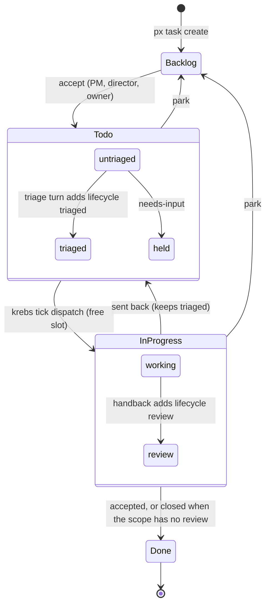

# Krebs lifecycle v2

Krebs is the name of the one ticket lifecycle every 33GOD board follows. It is also the name of the small state manager that enforces it. The machine-readable spec is [`spec/lifecycle.v2.yaml`](../spec/lifecycle.v2.yaml). This page explains it.

It replaces two things:

- `spec/lifecycle.v1.yaml`, the nine-phase lifecycle.
- Momo, the skill that pushed tickets through the lifecycle by prompt.

## Owner decisions (2026-11-14)

1. **Stock lanes everywhere.** Every board uses Plane's five lanes: Backlog, Todo, In Progress, Done, Cancelled. The nine-lane layout is retired, and labels now carry what the extra lanes used to mean. The verdict rules changed to fit.
2. **Todo means triage, then two slots.** A ticket entering Todo starts a triage turn. When triage finishes it adds `lifecycle:triaged`, and the pickup chip removes `agent:working`. Each project keeps two implementation slots busy with triaged Todo tickets. It stops only when no tickets are left, or when the rest are waiting on a person.
3. **Krebs replaces Momo.** A deterministic state manager now does the work that a prompt-driven skill used to do.

## Lanes and labels

| Lane | Meaning |
|---|---|
| Backlog | The owner's queue (the default lane). Nothing runs from here. |
| Todo | Accepted work. Entering Todo starts triage. A triaged ticket waits here for a slot. |
| In Progress | Work is being implemented, or the ticket is waiting for its verdict. |
| Done / Cancelled | Terminal. |

| Label | Meaning | Who sets it |
|---|---|---|
| `agent:working` | An agent turn is running right now. | The pickup chip and the Krebs dispatch. Agents never set it themselves. |
| `lifecycle:triaged` | Triage is finished and the ticket can take a slot. | The triage turn, as its last action. |
| `lifecycle:review` | The work was handed back and is waiting for a verdict. Only valid in In Progress. | The implementation turn. |
| `lifecycle:needs-input` | Waiting on a person. The question is in a comment. | Any turn. |
| `lifecycle:blocked` | Waiting on another ticket or an outside dependency. Record the blocker as a relation. | Any turn. |
| `agent:failed` | A turn failed and nobody has looked at it yet. | Lane errors. |

Three of these are hold labels: `lifecycle:needs-input`, `lifecycle:blocked` and `agent:failed`. A held ticket is never dispatched and never takes a slot.

## Flow

## Slots

- **Unit:** one registry row in `agents-registry.yaml`, meaning a board, or a board plus a scope label. TOLT, for example, has separate slots for `repo:game`, `repo:forge` and `repo:tolt`.
- **Count:** 2 by default. A row can override it with `plane.wip`.
- **What counts as occupied:** an In Progress ticket that has neither `lifecycle:review` nor a hold label. Waiting on a verdict or on a person does not hold a slot.
- **Over the limit:** the queue drains. Krebs never evicts a ticket; it dispatches nothing until a slot frees up.

## Who does what

| Step | Owner |
|---|---|
| Triage on Todo entry | The n8n Ticket Triage lane, which sends a triage turn to the scope's owner agent. |
| Dispatch Todo → In Progress | `krebs tick`, on the Candybar `krebs-tick` schedule. Nothing else dispatches. |
| Handback | The implementation turn. It adds `lifecycle:review` and an evidence comment, or closes the ticket if the scope has no review step. |
| Verdict | The Launch Director, or the PM where there is none. Accepted means Done. Sent back means Todo, with the comment `returned: <criterion>`. |
| Accept, park, cancel, Todo order | PM passes, through px or px-apply. |

The dispatch guard requires all of the following:

- a free slot
- `lifecycle:triaged`
- no `agent:working`
- no hold label
- not an epic container
- no open blocking relation

Candidates are taken in Plane's Todo order (`sort_order`), then by priority, then by sequence id.

## What it replaces

| Before | Now |
|---|---|
| Nine lanes (Refining, Ready, E2E Testing & QA, In Review, Needs Attention…) | Five lanes plus the labels above |
| The QA-lane verdict | `lifecycle:review` inside In Progress |
| Delegation fired on every Todo entry | Triage on Todo entry. Dispatch only from `krebs tick`. |
| WIP 1, written in prose | 2 slots per scope, enforced in code |
| Momo's WIP lock | The `board-lease.py` script in interval-driver |
| Momo's `record-decision.py` | `skills/krebs/scripts/record-decision.py` |
| The managed v2 execution engine (Postgres/NATS) | Retired. Projects fenced to `execution.mode` other than legacy are skipped. |
